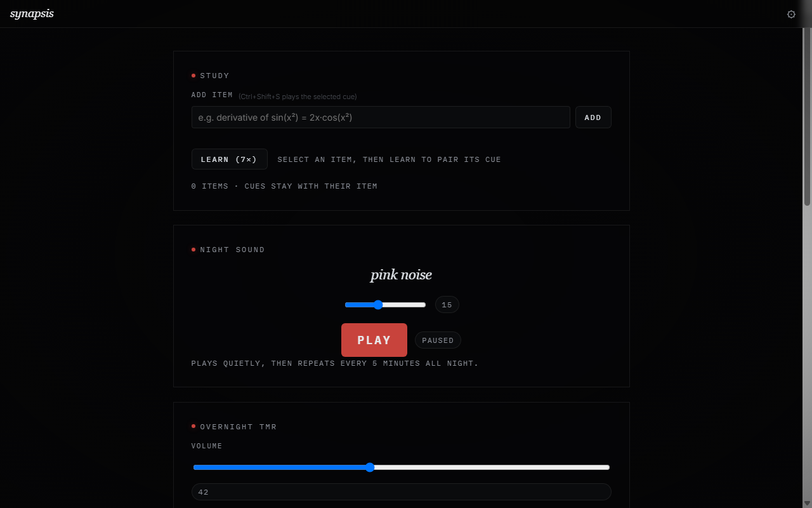

# tmr

A study-timer that works with your sleep, not against it. Desktop app
(Electron) with an optional Android build (Capacitor).



**Status**: syntax-checked main + renderer · honest about what it can't know · MIT

## Demo: the alignment estimate, printed

```text
TMR night simulation — alignment estimate (not a measurement)
==========================================================
study session ends:        00:30 (60 min lead-in after 23:30 start)
cue window:                00:30 - 04:30  (4.0 h cap)
cue cadence:               every 18 min  -> 13 cues
assumed sleep onset:       00:50
night ends:                07:00

cues landing in spindle-rich phase: 4/13
alignment estimate: 31%  (simulation only — no real sleep data)
```

This is exactly the estimate the app shows after a night — derived from your
session timing and textbook cycle math, never from sensor data (there is none).

## What it does

- **Study blocks**: 10 minutes on / 8 minutes off cycles, with a lead-in
  period before the first block so you can settle in.
- **Audio cues during sleep**: after a study session ends, the app can play
  soft, deterministic cue tones during sleep — timed to line up with windows
  when cueing is least likely to interrupt deep sleep. Cues replay a melody
  associated with what you studied (optionally with TTS).
- **Morning recall**: when you wake, the app asks what you remember and keeps
  a night log, so you can compare nights.
- **Alignment estimate — a simulation, not measurement**: the app *estimates*
  how well its cue schedule lined up with spindle-rich sleep windows using
  your session timing (lead-in, cap, cycle length) and simple sleep-cycle
  math. It is explicitly labeled as an estimate: **no real physiological data
  is collected, and no device sensor is read.** Treat the alignment number as
  a planning aid, not a measurement.

## Honest-boundary notes

- The cue-scheduling logic follows publicly reported properties of sleep
  (cycle lengths, spindle-rich windows in the second half of the night), but
  tmr does **not** verify your sleep stage. Everything downstream of "when
  did the session end" is an estimate.
- Cue volume is capped low by design; the app never tries to wake you.

## Setup (desktop)

```bash
npm install
npm start          # Electron app
```

Requires Node 18+. All data stays in local storage / local app data; nothing
is uploaded anywhere.

## Android build (optional)

```bash
npm run build      # web assets
npx cap add android
npx cap open android
```

The Android package id is `com.synapsis.tmr`.

## Tests

```bash
node --check electron/main.js
node --check www/app.js
```

## License

MIT — see [LICENSE](LICENSE).
